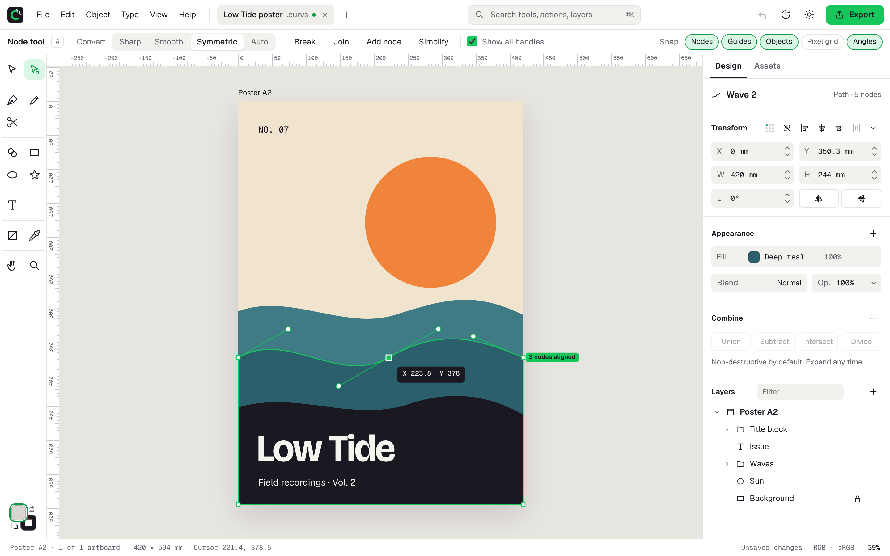

<div align="center">

<picture>
  <source media="(prefers-color-scheme: dark)" srcset="docs/brand/lockup-on-dark-transparent.svg">
  
</picture>

**Professional vector design in your browser.**

Pen and node tools, live booleans, appearance stacks, every Google Font, and export to SVG, PDF, AI, EPS, DXF, EMF and PNG.<br>
No install, no account, and your files never leave your device.

### [Open curvesmith.app →](https://curvesmith.app)

[Features](#features) · [File formats](#file-formats) · [Shortcuts](#keyboard-shortcuts) · [Run it locally](#run-it-locally) · [Contributing](#contributing)

<br>

<picture>
  <source media="(prefers-color-scheme: dark)" srcset="docs/images/screenshot-dark.png">
  
</picture>

</div>

---

## Features

**Drawing**
- **Pen** with corner/curve clicks, ⌥ to break a handle, Space to move the anchor, and Smart, Polygon and Line modes.
- **Node tool**: convert nodes to Sharp, Smooth, Symmetric or Auto, bend segments by dragging, break, join, add, simplify.
- **Pencil** that fits freehand strokes to clean Béziers, **Scissors** with a knife drag, and a **Shape builder** that merges or erases regions.
- **Parametric shapes**: rectangles with per-corner round, chamfer and inset corners; ellipses with pie arcs; stars and polygons with depth and rounding. All editable from on-canvas widgets.
- **Text**: point and area text with tracking, leading and OpenType features, and outlines on demand.

**Styling**
- **Appearance stacks**: any number of fills, strokes and effects per object, with linear, radial and conic gradients and blend modes.
- **Strokes**: inside, center or outside alignment, dashes, arrowheads and variable width profiles.
- **Effects**: drop shadow, inner shadow and blur.
- **Assets**: global colors that update every use, symbols with live instances, and saved styles.
- **Fonts**: a searchable picker with previews of nearly 2,000 Google Fonts, sorted by category.

**Working fast**
- **Live booleans** (union, subtract, intersect, exclude) that stay editable, plus Divide, compound paths and clip groups.
- **Smart guides and HUD**: snapping to edges, centers, nodes, guides and the pixel grid, with labels like “3 nodes aligned” and live coordinates.
- **Numeric fields that do math**: `120/3`, `+12`, `50%`, `10mm`. Step with the arrows, or pick a preset in ranged fields.
- **Command palette** (⌘K / Ctrl+K) over tools, commands, layers, colors and recent files.
- **Unlimited undo** with a history panel. History survives reloads through autosave.

**Local-first**
- Saves straight back to your file in Chromium browsers (File System Access API) and downloads elsewhere.
- Autosaves to this device every 30 seconds.
- Installable as an app (PWA) that works offline and opens `.curvs` and `.svg` files from the desktop.
- Printing sends true vector pages to the printer.

## File formats

| Format | Open | Export | Notes |
|---|:-:|:-:|---|
| `.curvs` | Yes | Yes | Native, lossless ZIP package. [Specification](docs/CURVS_FORMAT.md) |
| SVG / SVGZ | Yes | Yes | Text kept or outlined, attributes / inline CSS / classes, decimal control |
| PDF | Yes | Yes | Vector pages, embedded fonts, layers, bleed and crop marks |
| AI | Yes | Yes | PDF-compatible files. Export is PDF-based, so Illustrator-only editing data is not written. |
| EPS | | Yes | PostScript level 3 |
| DXF | Yes | Yes | For CAD, laser and vinyl cutters (R12) |
| EMF | | Yes | For Microsoft Office |
| PNG / JPG / WebP | as images | Yes | 1×, 2×, 3× or a custom size; PNGs carry their DPI |

Whenever a file opens with changes (a substituted font, a dropped filter), an import report lists them.

## Keyboard shortcuts

| | | | |
|---|---|---|---|
| Move `V` | Node `A` | Pen `P` | Pencil `N` |
| Scissors `C` | Shape builder `⇧M` | Rectangle `M` | Ellipse `L` |
| Star `*` | Text `T` | Gradient `G` | Eyedropper `I` |
| Hand `H` / `Space` | Zoom `Z` | Search `⌘K` | Export `⇧⌘E` |
| Save `⌘S` | Group `⌘G` | Transform again `⌘D` | Fit `⌘0` · 100% `⌘1` |

On Windows and Linux, Ctrl replaces ⌘. Help › Keyboard shortcuts lists them all.

## Run it locally

```sh
npm install
npm run dev          # http://localhost:5186
```

| Script | |
|---|---|
| `npm test` | Unit tests (Vitest) |
| `npm run test:e2e` | End-to-end tests (Playwright) |
| `npm run lint` · `npm run typecheck` | ESLint and TypeScript |
| `npm run build` | Production build into `dist/` |
| `npm run screenshot` | Regenerate README, tour and social preview images |
| `npm run fonts:update` | Refresh the Google Fonts catalog |

Pushes to `main` are tested and deployed to GitHub Pages by `.github/workflows/pages.yml`.

## How it is built

- **React + Zustand** for the interface, with **Radix UI** primitives and **cmdk** for the palette.
- A framework-free **document model** (`src/core`): geometry, transforms and **Immer**-patch history.
- A **Canvas2D** renderer, plus a separate overlay layer for crisp handles at any zoom.
- **Skia PathOps** (pathkit-wasm) for booleans and stroke outlining.
- **pdf-lib**, **pdf.js**, **opentype.js** and **fflate** for the file formats.

## Contributing

Bug reports and feature requests are welcome in the [issue tracker](https://github.com/theanam/curvesmith.app/issues). For anything else, email [anam.ahmed.a@gmail.com](mailto:anam.ahmed.a@gmail.com).

Pull requests should include tests (`npm test` and `npm run test:e2e` must pass).

## License

[MIT](LICENSE). Bricolage Grotesque, Geist and Geist Mono are bundled under the SIL Open Font License 1.1.
